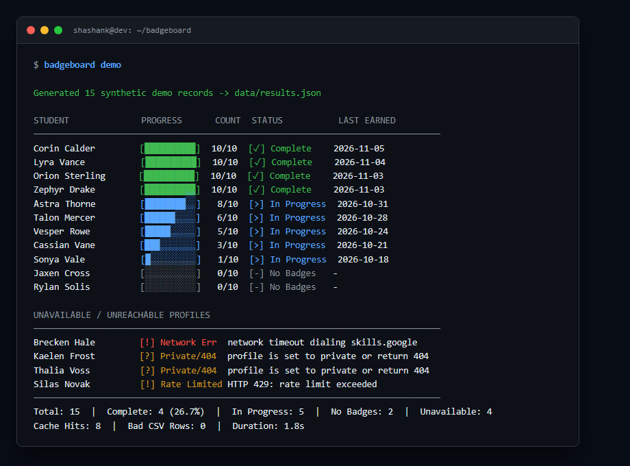
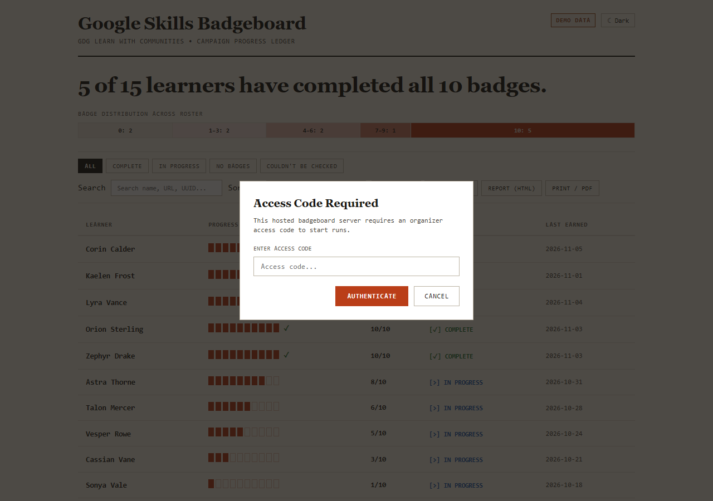
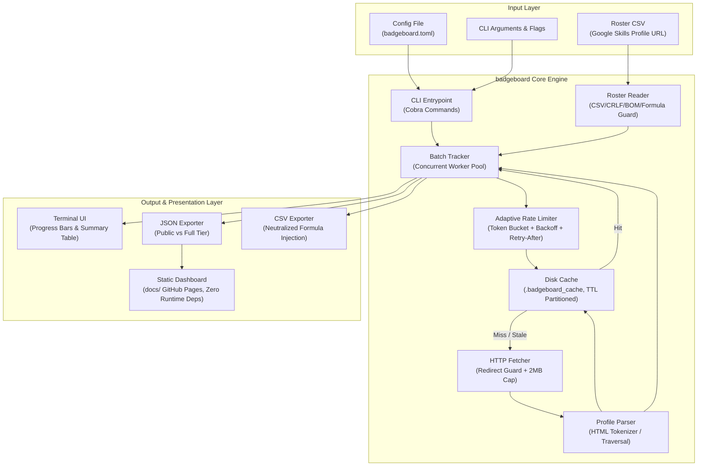

# badgeboard

[](https://github.com/NotRealShanks/badgeboard/actions/workflows/ci.yml)
[](LICENSE)

badgeboard is a resilient, privacy-first command-line progress tracker and static web dashboard for the Google Developer Groups (GDG) Learn With Communities campaign.





---

## Architecture Overview



---

## Key Capabilities

- **Polite and Adaptive Scraping**: Token-bucket rate limiting (1.0 request/sec default) across 2 concurrent workers, full jitter exponential backoff on transient failures, HTTP 429 / 503 handling, and strict adherence to upstream `Retry-After` headers triggering an immediate global cool-down across all workers.
- **Resilient HTML Parser**: Parses Google Skills public profile HTML without relying on fragile third-party browser automation frameworks. Enforces a 2 MB response body cap, follows HTTP 302 redirects to identify private accounts, and handles all DOM variations (complete, in-progress, zero badges, private, legacy layout).
- **Partitioned Disk Caching**: On-disk persistent cache indexed by SHA-256 profile hash. Employs status-based TTL expiration: 6 hours for successful (`200 OK`) profiles, 15 minutes for `PrivateOrNotFound` profiles, and 0 seconds (never cached) for transient network or rate-limiting errors. Supports offline evaluation against cached profile data.
- **Two Data Privacy Tiers**:
  - **Public Anonymized Tier (`--anonymize`)**: Employs keyed HMAC-SHA256 (`Learner-XXXX`) derived from an out-of-band secret salt. Completely redacts badge titles, individual completion dates, leagues, points, URLs, UUIDs, and full-precision timestamps to eliminate quasi-identifier linkage.
  - **Detailed Anonymized Tier (`--anonymize --include-badges`)**: Retains badge catalog titles and date-only timestamps for detailed drill-down views while stripping all upstream URLs and user identifiers.
- **Formula Injection Neutralization**: Automatically prefixes cells starting with `=`, `+`, `-`, `@`, `\t`, or `\r` with a single quote (`'`) in both Go CLI CSV exports and client-side web exports.
- **Static Web Dashboard (`docs/`)**: Vanilla HTML5, CSS3, and JavaScript requiring zero runtime dependencies, node modules, or bundlers. Fully responsive down to 360px viewports, passes WCAG 2.1 AA accessibility guidelines (100/100 Lighthouse score, 0 axe-core violations), and enforces a strict Content Security Policy.

---

## Installation

### Prerequisites
- Go 1.22 or higher.

### From Source
```bash
git clone https://github.com/NotRealShanks/badgeboard.git
cd badgeboard
go build -o bin/badgeboard ./cmd/badgeboard
```

### Install to GOBIN
```bash
go install ./cmd/badgeboard
```

---

## 60-Second Quickstart

### 1. Generate Synthetic Demo Data
Generate a realistic 15-student cohort with varying completion rates and unavailable states:
```bash
badgeboard demo
```
Output is rendered directly to the terminal, and saved as a JSON data file for the web dashboard at `docs/data/results.json`.

### 2. Inspect a Single Profile
Check an individual learner's progress without requiring a CSV file:
```bash
badgeboard check https://www.skills.google/public_profiles/11111111-2222-3333-4444-555555555555
```

### 3. Track a Full Roster
Evaluate a student roster CSV against a campaign target of 10 badges:
```bash
badgeboard run students.csv --goal 10
```

### 4. Export Anonymized Results for Public Publication
Generate public leaderboard data with irreversible pseudonyms:
```bash
export BADGEBOARD_SALT="campaign-secret-salt-key-2026"
badgeboard run students.csv --anonymize --format json --out docs/data/results.json
```

---

## CSV Format Specifications

The primary evaluation format is a single-column CSV containing public profile links:

```csv
Google Skills Profile URL
https://www.skills.google/public_profiles/11111111-2222-3333-4444-555555555555
https://www.skills.google/public_profiles/22222222-3333-4444-5555-666666666666
```

### Roster Parsing Guarantees:
- **Header Matching**: Case-insensitive matching for `Google Skills Profile URL` or `Profile URL`. If a `Name` or `Student Name` column is present, it is mapped to the learner display name.
- **Encoding & Line Breaks**: Seamlessly handles UTF-8 BOM, standard UTF-8, Windows CRLF (`\r\n`), and Unix LF (`\n`).
- **Resilient Cleansing**: Automatically skips empty rows, strips leading and trailing whitespace, and flags invalid UUID formats or malformed hostnames in a non-fatal bad-rows report.

---

## Command and Flag Reference

### Global Flags
| Flag | Default | Description |
|---|---|---|
| `-c, --config string` | `""` | Path to `badgeboard.toml` configuration file |
| `--goal int` | `10` | Badge milestone goal for campaign completion |
| `--rps float` | `1.0` | Maximum sustained HTTP requests per second |
| `--concurrency int` | `2` | Maximum concurrent background fetch workers |
| `--anonymize` | `false` | Enable pseudonymization and mask PII |
| `--include-badges` | `false` | Include badge details in anonymized output |
| `--salt-file string` | `""` | Path to file containing HMAC secret salt |
| `--demo-salt` | `false` | Allow fixed non-secret salt for testing/demo |
| `--refresh` | `false` | Bypass disk cache and force upstream re-fetch |
| `--no-cache` | `false` | Disable disk cache entirely (read/write nothing) |
| `--no-color` | `false` | Suppress ANSI terminal color sequences |
| `-v, --verbose` | `false` | Emit detailed diagnostic logs |

### Subcommands

#### `badgeboard run <roster.csv>`
Executes batch processing on a participant roster.
- `--format string`: Output format (`text`, `json`, `csv`). Default: `text`.
- `-o, --out string`: Output destination file path.

#### `badgeboard check <url>`
Inspects a single profile URL and prints formatted status and badge catalog.
- `--format string`: Output format (`text`, `json`). Default: `text`.

#### `badgeboard demo`
Generates a deterministic 15-record synthetic cohort for local development and dashboard testing.
- `--format string`: Output format (`text`, `json`, `csv`). Default: `text`.
- `-o, --out string`: Output file path. Default: `data/results.json`.

#### `badgeboard cache`
Displays cache metrics (total entries, storage size, expired count).
- Subcommand `clear`: Deletes all stored cache entries on disk.

#### `badgeboard version`
Prints version, git commit SHA, and build timestamp.
- `--short`: Prints only the semantic version string.

---

## Exit Codes

badgeboard uses standard exit codes for CI/CD integration:
- `0`: Success — all profiles were successfully evaluated and reached the campaign badge goal.
- `1`: Partial Completion / Incomplete — one or more profiles are still in progress, have zero badges, or encountered profile-level errors (e.g., private profiles).
- `2`: Configuration / Input Error — invalid flags, unreadable CSV file, malformed configuration, or missing anonymization salt.
- `3`: Fatal System Error — rate-limit exhaustion, network failure, or total evaluation failure.

---

## Configuration File (`badgeboard.toml`)

CLI flags can be preconfigured in a `badgeboard.toml` file located in the working directory or specified via `--config`:

```toml
goal = 10
rps = 1.0
concurrency = 2
anonymize = false
include_badges = false
no_cache = false
no_color = false
verbose = false

# Optional list of required badge names that count towards the goal
# required_badges = [
#   "Perform Foundational Data, ML, and AI Tasks in Google Cloud",
#   "Build and Secure Networks in Google Cloud"
# ]

# Optional campaign activity window
# [window]
# start = "2026-10-01T00:00:00Z"
# end = "2026-11-30T23:59:59Z"
```

---

## Status Classification Matrix

| Status | Meaning | Retryable | Cached |
|---|---|---|---|
| `Complete` | Reached or exceeded the campaign badge goal within the window. | No | Yes (6h TTL) |
| `InProgress` | Profile is public and has earned 1 to (goal - 1) eligible badges. | Yes | Yes (6h TTL) |
| `NoBadges` | Profile is public and active, but has earned 0 eligible badges. | Yes | Yes (6h TTL) |
| `PrivateOrNotFound` | Profile returns HTTP 404 or redirects (HTTP 302) to the login/private page. | Yes | Yes (15m TTL) |
| `InvalidURL` | URL does not match `https://www.skills.google/public_profiles/<uuid>`. | No | No |
| `RateLimited` | Server returned HTTP 429; backed off and cooled down. | Yes | No (0s TTL) |
| `NetworkError` | DNS failure, TLS handshake failure, or connection timeout. | Yes | No (0s TTL) |
| `ParseError` | Profile returned HTTP 200 but DOM structure could not be interpreted. | Yes | No (0s TTL) |

---

## Rate Limiting and Upstream Politeness

badgeboard adheres to responsible scraping practices:
1. **Token Bucket Rate Limiting**: Defaults to 1 request per second globally across all workers.
2. **Worker Pool Concurrency**: Defaults to 2 concurrent worker goroutines.
3. **Exponential Backoff with Full Jitter**: Retries transient 5xx server errors with backoff calculated as `t = min(max_interval, base * 2^attempt) * random(0.5, 1.5)`.
4. **Retry-After Global Cool-Down**: When an upstream HTTP 429 response includes a `Retry-After` header, the entire crawler pauses globally for the duration specified by the server.
5. **Payload Limiting**: Response bodies are capped at 2 MB via `io.LimitReader` to prevent memory exhaustion from unexpected binary payloads.
6. **Descriptive User-Agent**: Every request identifies the tool and version:
   `badgeboard/1.0 (+https://github.com/NotRealShanks/badgeboard)`

---

## Privacy and Anonymization

real participant data must never be published without the organizers' explicit permission.

### HMAC-SHA256 Pseudonym Derivation
Pseudonyms are generated deterministically using HMAC-SHA256:
$$\text{HMAC-SHA256}(\text{UUID}, \text{Salt})$$
The first 4 hex bytes are formatted as `Learner-XXXX`. This ensures:
- **Irreversibility**: Third parties cannot recover the student's original UUID without the out-of-band secret salt.
- **Linkage Elimination**: Public datasets omit profile URLs, leagues, points, individual badge names, and sub-second timestamps.
- **Salt Security**: `--anonymize` refuses to execute without an explicit `BADGEBOARD_SALT` environment variable or `--salt-file`, preventing accidental zero-salt disclosures.

### Formula Injection Defense
Both the Go CLI exporter and the client-side JavaScript export utility inspect every text field. Any string beginning with `=`, `+`, `-`, `@`, `\t`, or `\r` is prepended with a single quote (`'`), neutralizing dynamic formula execution in spreadsheet applications such as Microsoft Excel and Google Sheets.

---

## Static Web Dashboard (`docs/`)

The web dashboard is designed for static hosting on GitHub Pages:
- **Zero Runtime Dependencies**: Written entirely in vanilla HTML5, CSS3, and modern JavaScript.
- **Self-Hosted Typography**: Includes OFL-licensed local WOFF2 font files (**Fraunces** for headings and **JetBrains Mono** for numerical metrics).
- **Strict Content Security Policy**:
  ```text
  default-src 'self'; script-src 'self'; style-src 'self'; img-src 'self' data:; connect-src 'self'; font-src 'self'; object-src 'none'; base-uri 'self';
  ```
- **Accessibility & Performance**: Passes WCAG 2.1 AA with a 100/100 Lighthouse accessibility score and 0 axe-core automated audit violations.

---

## Test Suite & Code Quality

### Statement Coverage
The codebase maintains comprehensive automated test coverage across all internal packages:

| Package | Statement Coverage |
|---|---|
| `internal/fetch` | 92.7% |
| `internal/tracker` | 90.0% |
| `internal/roster` | 89.3% |
| `internal/config` | 88.7% |
| `internal/export` | 87.6% |
| `internal/parse` | 87.3% |
| `internal/ratelimit` | 86.4% |
| `internal/cache` | 80.0% |
| `internal/ui` | 73.7% |
| `internal/model` | 60.7% |
| `cmd/badgeboard` | 38.2% |

### Running Tests
```bash
# Execute unit test suite with race detector
go test -race -cover ./...

# Verify timezone invariance (UTC and Asia/Kolkata)
TZ=UTC go test -race ./...
TZ=Asia/Kolkata go test -race ./...

# Run client-side formula neutralization tests
node docs/csv_export.test.js

# Run static analysis
golangci-lint run ./...
```

---

## Limitations

- **Scraping Dependency**: badgeboard extracts progress by parsing publicly accessible HTML markup. If Google changes the public profile DOM structure or introduces mandatory JavaScript rendering, the parser will classify profiles as `ParseError` rather than reporting incorrect badge counts.
- **Private Profiles**: Badges on private profiles cannot be enumerated without authenticated administrative API access. Profiles marked private or returning HTTP 404 are classified as `PrivateOrNotFound`.
